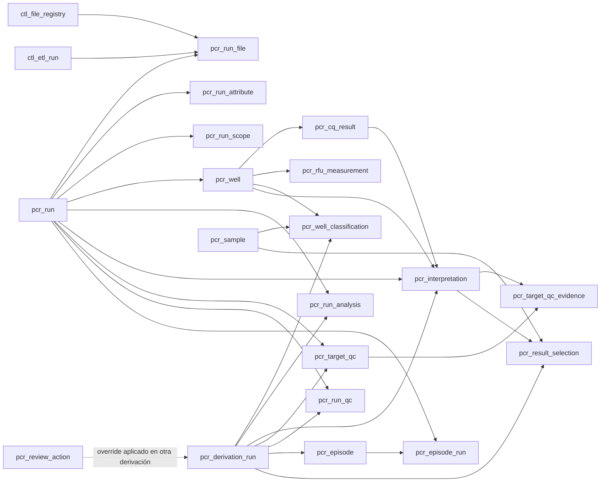

# Modelo de datos PCR

## Alcance y fuentes

Este documento describe las tablas cuyo nombre comienza por `pcr_` y las vistas
`v_pcr_` definidas por el repositorio. Se ha elaborado exclusivamente a partir
del código y de los documentos Markdown del proyecto, en particular:

- `src/fis_data/schema.py`;
- `src/fis_data/etl/pcr/materializer.py`;
- `src/fis_data/etl/pcr/analytics/`;
- `src/fis_data/etl/pcr/enums.py`;
- `src/fis_data/etl/pcr/review/`;
- `README.md`, `docs/pcr-review.md` y `docs/pcr-excel-parser-plan.md`.

No se ha abierto ni consultado ninguna base SQLite ni ningún fichero de
`data/`. Por tanto, este texto documenta el contrato implementado en el código,
no el contenido ni el volumen real de una base desplegada.

Los identificadores SQL están definidos en minúsculas (`pcr_run`, por ejemplo).
La referencia informal a tablas `PCR_` debe entenderse como este mismo
namespace lógico.

## Visión general

El modelo tiene tres capas:

1. **Evidencia materializada**: normaliza los Excel PCR ya parseados sin perder
   el enlace al fichero, fila raw y ejecución ETL de origen.
2. **Analítica derivada**: clasifica pozos y runs, interpreta curvas, calcula
   QC, agrupa episodios y selecciona resultados. Todas sus filas pertenecen a
   una derivación versionada y son reconstruibles.
3. **Revisión humana**: conserva eventos append-only. No se reconstruye al
   ejecutar de nuevo la analítica.

| Capa | Tablas |
| --- | --- |
| Evidencia materializada | `pcr_run`, `pcr_run_scope`, `pcr_run_file`, `pcr_run_attribute`, `pcr_well`, `pcr_cq_result`, `pcr_rfu_measurement` |
| Analítica derivada | `pcr_derivation_run`, `pcr_sample`, `pcr_well_classification`, `pcr_run_analysis`, `pcr_interpretation`, `pcr_target_qc`, `pcr_target_qc_evidence`, `pcr_run_qc`, `pcr_episode`, `pcr_episode_run`, `pcr_result_selection` |
| Revisión y auditoría | `pcr_review_action` |

En total hay **19 tablas físicas PCR** y **7 vistas públicas PCR**.



## Convenciones transversales

### Identificadores y cardinalidad

- Las claves con sufijo `_id` son enteros.
- Las tablas de entidad usan normalmente una clave sustituta autoincremental.
- Varias tablas derivadas usan una clave primaria compuesta que comienza por
  `derivation_id`. La misma entidad fuente puede, por ello, tener una versión
  distinta en cada derivación.
- Las relaciones indicadas como FK son las declaradas por SQLAlchemy. Algunos
  identificadores de auditoría, como `source_derivation_id`, son referencias
  lógicas sin `ForeignKey` declarada.

### Linaje ETL

Las tablas de evidencia enlazan con el modelo de control general:

- `source_id` → `ctl_source`;
- `file_id` → `ctl_file_registry`;
- `raw_excel_row_id` → `raw_excel_rows`;
- `run_id` → `ctl_etl_run`.

Aquí `run_id` significa **ejecución ETL**. No debe confundirse con
`pcr_run_id`, que identifica una ejecución experimental PCR.

### JSON

Los campos terminados en `_json` son `TEXT` que contiene JSON serializado. El
esquema no impone su forma mediante constraints SQL; el contrato lo establece
el código productor. Puede contener arrays, objetos, escalares o `null`, según
el campo.

### Booleanos

Los booleanos se declaran con `Boolean`. En el SQL SQLite del repositorio se
comparan también con `0` y `1`.

### Derivación vigente

La vigencia no se infiere del orden de los IDs ni de las fechas. Se controla
explícitamente mediante `pcr_derivation_run.is_current`. Las vistas seleccionan:

```sql
SELECT derivation_id
FROM pcr_derivation_run
WHERE status = 'SUCCESS'
  AND is_current = 1
```

Solo puede existir una fila con `is_current = 1`, garantizado por el índice
único parcial `uq_pcr_derivation_run_current`. Una derivación comienza con
`is_current = 0`. Al terminar correctamente, el repositorio desactiva la
vigente anterior y activa la nueva dentro de la misma transacción. Una
derivación fallida permanece inactiva y no desplaza a la vigente.

Al abrir por primera vez una base creada con el esquema anterior,
`create_schema` añade el campo y realiza una migración de transición: marca
como vigente la derivación `SUCCESS` de mayor ID que antes habría usado el
sistema. Esta inferencia se ejecuta una sola vez para conservar el
comportamiento previo; después de la migración, la selección siempre depende
exclusivamente de `is_current`.

## Capa de evidencia materializada

### `pcr_run`

Representa un run experimental PCR. Varios Excel complementarios —Cq,
amplificación y curvas de melting— se agrupan en el mismo run mediante el valor
`File Name` de la hoja `Run Information`.

| Columna | Tipo | Nulo | Significado |
| --- | --- | --- | --- |
| `pcr_run_id` | Integer, PK, autoincremental | No | Identificador del run PCR. |
| `source_id` | Integer, FK → `ctl_source.source_id` | No | Fuente lógica a la que pertenece. |
| `run_name` | String(255) | No | Nombre original obtenido de `File Name`. |
| `run_name_normalized` | String(255) | No | Nombre normalizado para emparejar ficheros. |
| `run_started` / `run_ended` | DateTime | Sí | Fechas de inicio y fin CFX normalizadas. |
| `created_by_user` | String(255) | Sí | Usuario que creó el run en CFX. |
| `base_serial_number` / `optical_head_serial_number` | String(255) | Sí | Números de serie del equipo. |
| `cfx_maestro_version` | String(255) | Sí | Versión de CFX Maestro. |
| `protocol_file_name` / `plate_setup_file_name` | String(255) | Sí | Ficheros de protocolo y configuración de placa. |
| `sample_vol` / `lid_temp` | String(255) | Sí | Volumen de muestra y temperatura de tapa declarados. |
| `notes` | Text | Sí | Notas del run. |
| `run_metadata_id` | String(255) | Sí | Valor del atributo CFX `ID`. |
| `source_file_name` | String(255) | Sí | Nombre de fichero declarado en `Run Information`. |
| `created_at` | DateTime | No | Alta, por defecto `CURRENT_TIMESTAMP`. |
| `updated_at` | DateTime | No | Marca definida con valor inicial `CURRENT_TIMESTAMP`; el esquema no declara actualización automática. |

**Unicidad:** `(source_id, run_name_normalized)`.

**Ciclo de vida:** el materializador hace un upsert lógico sobre esa clave. Al
reprocesar, elimina un run si ya no conserva ninguna fila en `pcr_run_file`.
Los campos de metadatos se sincronizan desde los atributos canónicos de
`pcr_run_attribute`; dicha tabla conserva la procedencia y los conflictos.

### `pcr_run_scope`

Define si un run puede participar en la analítica operativa. Es una decisión
persistente y auditable, independiente de la evidencia y de la fecha CFX.

| Columna | Tipo | Nulo | Significado |
| --- | --- | --- | --- |
| `pcr_run_id` | Integer, PK/FK → `pcr_run.pcr_run_id` | No | Run al que aplica el alcance. |
| `analytical_scope` | String(20) | No | `ROUTINE` o `EXPERIMENTAL`. Un run sin fila se trata como `ROUTINE`. |
| `reason` | Text | No | Justificación trazable de la política o excepción. |
| `assigned_by` | String(20) | No | Origen de la decisión: habitualmente `POLICY` o `MANUAL`. |
| `assigned_at` | DateTime | No | Alta de la asignación; por defecto `CURRENT_TIMESTAMP`. |

**Índice:** `idx_pcr_run_scope_scope (analytical_scope)`.

Los flujos de materialización y derivación crean o actualizan estas asignaciones
automáticamente a partir de `PCR_EXPERIMENTAL_BEFORE` o del parámetro de
política recibido por la derivación. Si no se indica otro valor, el corte es
`2023-07-01T00:00:00`. Los runs
`EXPERIMENTAL` conservan los datos fuente, pero no participan en la derivación
analítica ni en las vistas operativas de resultados.

### `pcr_run_file`

Tabla puente entre un run PCR y los Excel que lo componen. Un run puede tener
varios ficheros, pero cada fichero solo puede quedar asociado a un run PCR.

| Columna | Tipo | Nulo | Significado |
| --- | --- | --- | --- |
| `pcr_run_file_id` | Integer, PK, autoincremental | No | Identificador de la asociación. |
| `pcr_run_id` | Integer, FK → `pcr_run` | No | Run PCR destino. |
| `file_id` | Integer, FK → `ctl_file_registry` | No | Fichero Excel. |
| `run_id` | Integer, FK → `ctl_etl_run` | No | Ejecución ETL que materializó el enlace. |

**Unicidad:** `file_id`.

**Índice:** `idx_pcr_run_file_run (pcr_run_id)`.

### `pcr_run_attribute`

Conserva los pares clave/valor de `Run Information`. Puede haber una copia de
un mismo atributo en varios ficheros del run.

| Columna | Tipo | Nulo | Significado |
| --- | --- | --- | --- |
| `pcr_run_attribute_id` | Integer, PK, autoincremental | No | Identificador del atributo. |
| `pcr_run_id` | Integer, FK → `pcr_run` | No | Run al que describe. |
| `file_id` | Integer, FK → `ctl_file_registry` | No | Fichero que aportó el valor. |
| `raw_excel_row_id` | Integer, FK → `raw_excel_rows` | No | Fila parseada de origen. |
| `run_id` | Integer, FK → `ctl_etl_run` | No | Ejecución ETL de origen. |
| `attribute_key` | String(255) | No | Clave original. |
| `attribute_key_normalized` | String(255) | No | Clave canónica normalizada. |
| `value_json` | Text | Sí | Valor serializado como JSON. |
| `is_canonical` | Boolean | No | Indica la copia elegida como canónica; por defecto `0`. |
| `has_conflict` | Boolean | No | Indica discrepancias entre copias del atributo; por defecto `0`. |

**Unicidad:** `(file_id, attribute_key_normalized)`.

Tras materializar un fichero, el código recalcula `is_canonical` y
`has_conflict` para todo el run. Los atributos canónicos conocidos se
promueven también a `pcr_run`, incluidos `run_started`, `run_ended`, usuario,
equipo, versión CFX, protocolo y configuración de placa.

### `pcr_well`

Catálogo de pozos físicos de un run. Consolida metadatos compartidos por los
resultados Cq y las series RFU.

| Columna | Tipo | Nulo | Significado |
| --- | --- | --- | --- |
| `pcr_well_id` | Integer, PK, autoincremental | No | Identificador del pozo. |
| `pcr_run_id` | Integer, FK → `pcr_run` | No | Run al que pertenece. |
| `well` | String(20) | No | Posición tal como llega del Excel. |
| `well_normalized` | String(20) | No | Posición normalizada usada para enlazar exportaciones. |
| `sample_name` | String(255) | Sí | Nombre de muestra consolidado. |
| `content` | String(100) | Sí | Contenido o tipo indicado por el instrumento. |
| `file_id` | Integer, FK → `ctl_file_registry` | No | Fichero que respalda los metadatos actuales. |
| `raw_excel_row_id` | Integer, FK → `raw_excel_rows` | No | Fila raw que los respalda. |
| `run_id` | Integer, FK → `ctl_etl_run` | No | Ejecución ETL correspondiente. |

**Unicidad:** `(pcr_run_id, well_normalized)`.

La posición del pozo es la identidad estable dentro del run. Las series RFU
pueden crear primero el pozo sin metadatos de muestra; posteriormente el
resultado Cq completa `sample_name` y `content`. En un reprocesado se eliminan
los pozos que ya no tengan ni Cq ni mediciones RFU.

### `pcr_cq_result`

Resultado de cuantificación de una fila de la exportación Cq. Es la evidencia
principal que después se interpreta junto con la curva derivada del pozo.

| Columna | Tipo | Nulo | Significado |
| --- | --- | --- | --- |
| `pcr_cq_result_id` | Integer, PK, autoincremental | No | Identificador del resultado. |
| `pcr_run_id` | Integer, FK → `pcr_run` | No | Run PCR. |
| `pcr_well_id` | Integer, FK → `pcr_well` | No | Pozo medido. |
| `file_id` | Integer, FK → `ctl_file_registry` | No | Excel de origen. |
| `raw_excel_row_id` | Integer, FK → `raw_excel_rows` | No | Fila raw de origen. |
| `run_id` | Integer, FK → `ctl_etl_run` | No | Ejecución ETL. |
| `target` | String(255) | No | Diana informada por el instrumento, todavía no necesariamente canónica. |
| `fluor` | String(100) | Sí | Fluoróforo. |
| `sample_name` | String(255) | Sí | Nombre de muestra observado en esta fila. |
| `content` | String(100) | Sí | Contenido observado en esta fila. |
| `cq` | Float | Sí | Cq/Ct individual. |
| `cq_mean` | Float | Sí | Media de Cq exportada. |
| `cq_std_dev` | Float | Sí | Desviación estándar de Cq exportada. |

**Unicidad:** `raw_excel_row_id`.

**Índices:** `(pcr_run_id, pcr_well_id)`, `file_id` y `pcr_well_id`.

### `pcr_rfu_measurement`

Una observación RFU de una serie: amplificación, curva de melting o derivada de
melting. El formato ancho del Excel se desnormaliza a una fila por punto y
pozo.

| Columna | Tipo | Nulo | Significado |
| --- | --- | --- | --- |
| `pcr_rfu_measurement_id` | Integer, PK, autoincremental | No | Identificador de la observación. |
| `pcr_run_id` | Integer, FK → `pcr_run` | No | Run PCR. |
| `pcr_well_id` | Integer, FK → `pcr_well` | No | Pozo de la serie. |
| `file_id` | Integer, FK → `ctl_file_registry` | No | Excel de origen. |
| `raw_excel_row_id` | Integer, FK → `raw_excel_rows` | No | Fila ancha de origen. |
| `run_id` | Integer, FK → `ctl_etl_run` | No | Ejecución ETL. |
| `measurement_kind` | String(80) | No | Tipo de serie. |
| `axis_kind` | String(40) | No | Naturaleza del eje X. |
| `axis_value` | Float | No | Ciclo o temperatura. |
| `rfu` | Float | Sí | Intensidad RFU; puede faltar en el Excel. |

**Unicidad:** `(raw_excel_row_id, pcr_well_id)`.

**Índices:** `(pcr_run_id, measurement_kind, axis_value)`, `file_id` y
`pcr_well_id`.

Dominios implementados:

| `measurement_kind` | `axis_kind` | Procedencia |
| --- | --- | --- |
| `amplification_rfu` | `cycle` | Quantification Amplification Results |
| `melt_curve_rfu` | `temperature` | Melt Curve RFU Results |
| `melt_curve_derivative` | `temperature` | Melt Curve Derivative Results |

La interpretación analítica actual consume las filas
`measurement_kind = 'melt_curve_derivative'`, ordenadas por pozo y temperatura.

## Capa analítica derivada

### `pcr_derivation_run`

Cabecera de una ejecución del pipeline analítico. Proporciona versionado,
parámetros y estado a todas las tablas derivadas.

| Columna | Tipo | Nulo | Significado |
| --- | --- | --- | --- |
| `derivation_id` | Integer, PK, autoincremental | No | Identificador de derivación. |
| `algorithm_version` | String(100) | No | Versión declarada del algoritmo, por ejemplo `melting-v1`. |
| `rule_version` | String(40) | No | Versión de reglas de dominio; actualmente el repositorio usa `1.0`. |
| `parameters_json` | Text | No | Snapshot JSON de parámetros analíticos. |
| `status` | String(30) | No | Estado de ejecución. |
| `is_current` | Boolean | No | Control explícito de vigencia; por defecto `0`. Solo una derivación puede tener valor `1`. |
| `details_json` | Text | Sí | Resumen o detalle final de la ejecución. |
| `started_at` | DateTime | No | Inicio, por defecto `CURRENT_TIMESTAMP`. |
| `finished_at` | DateTime | Sí | Finalización; nulo mientras está en curso o si no se cerró. |

Estados implementados: `RUNNING`, `SUCCESS`, `FAILED`.

**Unicidad condicional:** el índice único parcial
`uq_pcr_derivation_run_current (is_current) WHERE is_current IS 1` impide que
dos derivaciones sean vigentes simultáneamente.

Con `derive-pcr --rebuild`, el repositorio vacía las tablas analíticas en orden
de dependencias antes de insertar una nueva cabecera. `pcr_review_action` queda
fuera de ese borrado.

### `pcr_sample`

Dimensión de muestra canónica, separada de los nombres observados en los pozos.

| Columna | Tipo | Nulo | Significado |
| --- | --- | --- | --- |
| `pcr_sample_id` | Integer, PK, autoincremental | No | Identificador interno. |
| `sample_key` | String(100), UNIQUE | No | Identidad canónica de muestra. |
| `created_at` | DateTime | No | Alta, por defecto `CURRENT_TIMESTAMP`. |

Los nombres puramente numéricos se reconocen como identificadores de muestra,
pero no se convierten a entero ni se eliminan sus ceros iniciales. Solo se
retira espacio exterior: `" 061991301 "` → `"061991301"`. Por tanto,
`"061991301"` y `"61991301"` son claves distintas y no colisionan. Un override
de pozo puede aportar explícitamente otra `sample_key`.

Aunque no lleva `derivation_id`, esta tabla forma parte del conjunto
reconstruible y se vacía con `--rebuild`.

Las bases derivadas con una versión anterior, que eliminaba ceros iniciales,
deben ejecutar `derive-pcr --rebuild` para regenerar `pcr_sample`, las
clasificaciones y las selecciones. No es seguro corregir esas claves en sitio:
una clave ya reducida no permite inferir si su nombre original tenía uno o
varios ceros.

### `pcr_well_classification`

Versión derivada de la identidad y rol analítico de cada pozo.

| Columna | Tipo | Nulo | Significado |
| --- | --- | --- | --- |
| `derivation_id` | Integer, PK, FK → `pcr_derivation_run` | No | Derivación que produjo la fila. |
| `pcr_well_id` | Integer, PK, FK → `pcr_well` | No | Pozo clasificado. |
| `pcr_sample_id` | Integer, FK → `pcr_sample` | Sí | Muestra canónica; solo cuando aplica. |
| `raw_sample_name` | String(255) | Sí | Nombre de muestra observado. |
| `normalized_name` | String(255) | Sí | Nombre normalizado o clave aportada por override. |
| `well_role` | String(40) | No | Rol analítico. |
| `rule_key` | String(100) | No | Regla automática o marca del override. |
| `content_evidence` | String(100) | Sí | `content` del pozo usado como evidencia. |
| `review_reason` | Text | Sí | Motivo de revisión; nulo si la clasificación es segura. |

**PK compuesta:** `(derivation_id, pcr_well_id)`.

**Índice:** `pcr_sample_id`.

Roles: `REAL_SAMPLE`, `POSITIVE_CONTROL`, `NEGATIVE_CONTROL`,
`NON_SAMPLE_REVIEW`.

Reglas automáticas:

- nombre compuesto exclusivamente por dígitos → `REAL_SAMPLE`, regla
  `NUMERIC`; `normalized_name` conserva todos los dígitos, incluidos los ceros
  iniciales;
- `CP`, `C+`, `CPNEW`, `CPOLD` → `POSITIVE_CONTROL`;
- `CN`, `C-`, `CNEG` → `NEGATIVE_CONTROL`;
- si `sample` está vacío y `content` contiene una etiqueta compatible con
  `Pos Ctrl` o `Neg Ctrl`, se clasifican respectivamente como
  `POSITIVE_CONTROL` o `NEGATIVE_CONTROL`, con reglas
  `CONTENT_POSITIVE_CONTROL` y `CONTENT_NEGATIVE_CONTROL`;
- si una muestra numérica tiene un `content` compatible con control, conserva
  el rol `REAL_SAMPLE` pero genera un motivo de revisión;
- vacío → `NON_SAMPLE_REVIEW`, regla `EMPTY`;
- otro texto → `NON_SAMPLE_REVIEW`, regla `UNKNOWN_TEXT`.

Un override usa `rule_key = 'MANUAL_OVERRIDE'` y elimina el motivo de revisión.

### `pcr_run_analysis`

Clasificación y metadatos analíticos de un run para una derivación.

| Columna | Tipo | Nulo | Significado |
| --- | --- | --- | --- |
| `derivation_id` | Integer, PK, FK → `pcr_derivation_run` | No | Derivación. |
| `pcr_run_id` | Integer, PK, FK → `pcr_run` | No | Run clasificado. |
| `run_class` | String(40) | No | Clase analítica. |
| `run_type` | String(20) | No | Categoría global: `SCREENING` o `SPECIFIC`. |
| `run_started` | DateTime | Sí | Inicio parseado desde el atributo canónico `run_started`. |
| `episode_date_key` | String(10) | Sí | Fecha ISO `YYYY-MM-DD` extraída del nombre o aportada por override. |
| `canonical_targets_json` | Text | No | Array JSON ordenado de dianas canonizadas presentes. |
| `review_reason` | Text | Sí | Causa por la que la clase necesita revisión. |

**PK compuesta:** `(derivation_id, pcr_run_id)`.

Clases implementadas:

- `SCREENING`: contiene la diana `Screening`;
- `PANEL_OXA48_VIM`: contiene al menos `16S`, `OXA48` y `VIM`;
- `PANEL_KPC_NDM`: contiene al menos `16S`, `KPC` y `NDM`;
- `COMPENSATION_PARTIAL`: contiene alguna diana de carbapenemasa sin formar
  uno de los paneles anteriores;
- `OTHER`: conjunto no reconocido; genera `review_reason`.

`run_type` separa los resultados de cribado (`SCREENING`) de los ensayos de
panel o específicos (`SPECIFIC`), sin perder la clase detallada en
`run_class`. Solo los runs cuya clase sea `SCREENING` pertenecen al primer
tipo; todos los demás pertenecen a `SPECIFIC`.

`run_started` espera el formato CFX `%m/%d/%Y %H:%M:%S UTC`. La fecha de
episodio se busca en el nombre como 6 u 8 dígitos en orden día-mes-año.

### `pcr_interpretation`

Llamada analítica producida al combinar un resultado Cq con la curva derivada
de melting del pozo.

| Columna | Tipo | Nulo | Significado |
| --- | --- | --- | --- |
| `interpretation_id` | Integer, PK, autoincremental | No | Identificador de la interpretación. |
| `derivation_id` | Integer, FK → `pcr_derivation_run` | No | Derivación. |
| `pcr_run_id` | Integer, FK → `pcr_run` | No | Run. |
| `pcr_well_id` | Integer, FK → `pcr_well` | No | Pozo. |
| `pcr_cq_result_id` | Integer, FK → `pcr_cq_result` | No | Resultado Cq interpretado. |
| `source_target` | String(100) | No | Diana original del resultado. |
| `canonical_target` | String(100) | No | Diana canónica asignada. |
| `call` | String(30) | No | Llamada resultante. |
| `cq` | Float | Sí | Cq usado en la interpretación. |
| `peak_temperature` | Float | Sí | Temperatura del pico seleccionado. |
| `peak_deriv_rfu` | Float | Sí | Altura RFU derivada del pico seleccionado. |
| `peaks_json` | Text | No | Picos detectados, serializados como JSON. |
| `metrics_json` | Text | Sí | Métricas adicionales del algoritmo. |
| `error` | Text | Sí | Error analítico, si lo hubo. |

**Unicidad:** `(derivation_id, pcr_cq_result_id, canonical_target)`.

**Índices:** `(pcr_run_id, canonical_target)` y `pcr_well_id`.

Llamadas: `POSITIVE`, `NEGATIVE`, `INDETERMINATE`, `ERROR`.

Una fila Cq de Screening puede producir varias interpretaciones canónicas. Si
falta la curva derivada, las dianas que la requieren producen `ERROR`.

Para una diana específica, un Cq válido con pico de melting fuera de la ventana
de la diana no se convierte en negativo: queda `INDETERMINATE` con
`error = 'MELTING_INCOMPATIBLE'`. El Cq y el pico observado se preservan, y
`metrics_json.compatible_targets_within_window` registra las dianas cuya
temperatura esperada está dentro de la ventana configurada (actualmente ±0.5
°C); una lista vacía indica que el pico no es compatible con ninguna diana. Una fila cuyo
target de origen contenga `FAIL` queda aislada como `INDETERMINATE`, con
`error = 'TARGET FAILED'`; no invalida las demás muestras, dianas, QC ni la
clasificación del run.

### `pcr_target_qc`

Evaluación de controles para una combinación run–diana.

| Columna | Tipo | Nulo | Significado |
| --- | --- | --- | --- |
| `derivation_id` | Integer, PK, FK → `pcr_derivation_run` | No | Derivación. |
| `pcr_run_id` | Integer, PK, FK → `pcr_run` | No | Run evaluado. |
| `canonical_target` | String(100), PK | No | Diana evaluada. |
| `qc_status` | String(30) | No | Estado de QC. |
| `is_valid` | Boolean | No | Si la diana puede contribuir a la selección final. |
| `positive_controls` | Integer | No | Número de observaciones/controles positivos considerados. |
| `negative_controls` | Integer | No | Número de observaciones/controles negativos considerados. |
| `warnings_json` | Text | No | Array JSON de advertencias. |
| `details_json` | Text | No | Evidencia: fallos, llamadas por rol y detalles de Screening. |

**PK compuesta:** `(derivation_id, pcr_run_id, canonical_target)`.

Estados de target: `VALID`, `WARNING`, `INVALID`. Un override de QC puede
aplicar también `VALID_WITH_WARNINGS`.

Incidencias posibles: `MISSING_POSITIVE_CONTROL`,
`MISSING_NEGATIVE_CONTROL`, `POSITIVE_CONTROL_NOT_POSITIVE`,
`POSITIVE_CONTROL_MELTING_INCOMPATIBLE`, `NEGATIVE_CONTROL_POSITIVE`,
`NEGATIVE_CONTROL_NOT_NEGATIVE` y `NEGATIVE_CONTROL_INDETERMINATE`.

`POSITIVE_CONTROL_MELTING_INCOMPATIBLE` distingue un control que amplificó
(Cq válido) pero cuyo pico no corresponde a la diana esperada de un control
que no fue positivo. Los detalles de pico y posible diana alternativa quedan
en la interpretación asociada.

En Screening los controles son globales: al menos una llamada del control
positivo debe ser positiva y todas las llamadas del control negativo deben ser
negativas. Si un control positivo amplifica pero todos sus picos quedan fuera
de las ventanas de las dianas Screening, se registra
`POSITIVE_CONTROL_MELTING_INCOMPATIBLE` en lugar de
`POSITIVE_CONTROL_NOT_POSITIVE`.

### `pcr_target_qc_evidence`

Trazabilidad persistida de cada interpretación de control incluida en la
evaluación de un QC run–diana. No contiene agregados: enlaza el QC con la
interpretación concreta que aporta Cq, melting, pico y error.

| Columna | Tipo | Nulo | Significado |
| --- | --- | --- | --- |
| `derivation_id` | Integer, PK/FK → `pcr_derivation_run` | No | Derivación. |
| `pcr_run_id` | Integer, PK | No | Run evaluado. |
| `canonical_target` | String(100), PK | No | Diana del QC. |
| `interpretation_id` | Integer, PK, FK → `pcr_interpretation` | No | Interpretación de control usada. |
| `well_role` | String(40) | No | `POSITIVE_CONTROL` o `NEGATIVE_CONTROL`. |

La clave `(derivation_id, pcr_run_id, canonical_target)` referencia a
`pcr_target_qc`. Una misma interpretación de control puede ser evidencia de
varios targets en un run de Screening.

### `pcr_run_qc`

Resumen agregado de QC por run.

| Columna | Tipo | Nulo | Significado |
| --- | --- | --- | --- |
| `derivation_id` | Integer, PK, FK → `pcr_derivation_run` | No | Derivación. |
| `pcr_run_id` | Integer, PK, FK → `pcr_run` | No | Run. |
| `qc_status` | String(30) | No | Estado agregado. |
| `valid_targets` | Integer | No | Número de dianas válidas. |
| `invalid_targets` | Integer | No | Número de dianas inválidas. |
| `warning_count` | Integer | No | Número de evaluaciones con advertencias. |

**PK compuesta:** `(derivation_id, pcr_run_id)`.

Estados agregados:

- todas las dianas inválidas → `INVALID`;
- alguna, pero no todas, inválida → `PARTIALLY_INVALID`;
- ninguna inválida y alguna advertencia → `VALID_WITH_WARNINGS`;
- sin invalidez ni advertencias → `VALID`.

### `pcr_episode`

Agrupación derivada de runs que pertenecen al mismo episodio analítico.

| Columna | Tipo | Nulo | Significado |
| --- | --- | --- | --- |
| `episode_id` | Integer, PK, autoincremental | No | Identificador del episodio. |
| `derivation_id` | Integer, FK → `pcr_derivation_run` | No | Derivación. |
| `episode_key` | String(100) | No | Clave estable dentro de la derivación. |
| `episode_date_key` | String(10) | Sí | Fecha ISO común inferida. |
| `association_status` | String(30) | No | Calidad de la asociación. |
| `review_reason` | Text | Sí | Motivo de revisión. |

**Unicidad:** `(derivation_id, episode_key)`.

Estados: `AUTO` y `REVIEW`.

Los runs no Screening se enlazan automáticamente si comparten fecha y tienen
solapamiento de muestras ≥ 0,8, o si pertenecen a clases compatibles y su
solapamiento es exactamente 1,0. El solapamiento se calcula como:

`|muestras A ∩ muestras B| / min(|A|, |B|)`.

Un override puede crear una membresía explícita en una derivación posterior.

### `pcr_episode_run`

Tabla puente entre episodios y runs, con evidencia de la asociación.

| Columna | Tipo | Nulo | Significado |
| --- | --- | --- | --- |
| `episode_id` | Integer, PK, FK → `pcr_episode` | No | Episodio. |
| `pcr_run_id` | Integer, PK, FK → `pcr_run` | No | Run miembro. |
| `run_role` | String(40) | No | Rol del run dentro del episodio. |
| `overlap_score` | Float | Sí | Solapamiento calculado; puede no aplicar. |
| `association_status` | String(30) | No | Estado heredado de la asociación. |

**PK compuesta:** `(episode_id, pcr_run_id)`.

**Índice:** `pcr_run_id`.

La PK impide repetir un run dentro del mismo episodio, pero el esquema SQL no
impone que un run solo pueda estar en un episodio de una derivación.

### `pcr_result_selection`

Resultado preferido para cada muestra y diana en una derivación. Resume todos
los candidatos elegibles sin borrar su historia.

| Columna | Tipo | Nulo | Significado |
| --- | --- | --- | --- |
| `derivation_id` | Integer, PK, FK → `pcr_derivation_run` | No | Derivación. |
| `pcr_sample_id` | Integer, PK, FK → `pcr_sample` | No | Muestra. |
| `run_type` | String(20), PK | No | Tipo global del run: `SCREENING` o `SPECIFIC`. |
| `canonical_target` | String(100), PK | No | Diana. |
| `preferred_interpretation_id` | Integer, FK → `pcr_interpretation` | Sí | Interpretación seleccionada; nula si no hay candidata válida. |
| `occurrence_count` | Integer | No | Número total de candidatas agrupadas. |
| `relation_kind` | String(40) | No | Relación entre ocurrencias. |
| `concordance` | String(30) | No | Concordancia de llamadas válidas. |
| `needs_review` | Boolean | No | Si requiere decisión humana. |
| `details_json` | Text | No | Detalle de candidatas y decisión, incluido el empate. |

**PK compuesta:** `(derivation_id, pcr_sample_id, run_type, canonical_target)`.

Relaciones: `SINGLE`, `CORRECTION`, `PANEL_COMPLEMENT`,
`HISTORICAL_REPEAT`.

Concordancia: `NO_VALID_RESULT`, `CONCORDANT`, `DISCORDANT`.

Solo son preferibles las interpretaciones de muestras reales cuyo QC sea
válido y cuya llamada sea `POSITIVE` o `NEGATIVE`. Se elige primero el run más
reciente por `run_started` y después por `pcr_run_id`. `needs_review` se activa
si no hay candidata válida, las llamadas discrepan o las dos candidatas más
recientes empatan en fecha. La selección se realiza de forma independiente por
`muestra + run_type + diana`: pueden coexistir un resultado vigente Screening y
otro Specific para la misma muestra y diana, pero no dos dentro del mismo tipo.

## Revisión y auditoría

### `pcr_review_action`

Registro inmutable de decisiones humanas. El estado actual de una revisión o
de un override se obtiene plegando los eventos por sujeto en orden de
`review_action_id`; las filas anteriores nunca se actualizan ni se borran.

| Columna | Tipo | Nulo | Significado |
| --- | --- | --- | --- |
| `review_action_id` | Integer, PK, autoincremental | No | Orden e identidad del evento. |
| `item_type` | String(30) | No | Tipo de elemento revisado. |
| `subject_key` | String(255) | No | Identidad estable del sujeto. |
| `issue_fingerprint` | String(64) | No | Hash de motivo y contexto que evita resolver evidencia obsoleta. |
| `source_derivation_id` | Integer | No | Derivación que originó la acción; referencia lógica, sin FK declarada. |
| `action` | String(30) | No | Acción auditada. |
| `resolution` | String(30) | Sí | Resultado de una resolución cuando aplica. |
| `override_kind` | String(30) | Sí | Clase tipada de corrección cuando aplica. |
| `payload_json` | Text | Sí | Datos estructurados de la corrección. |
| `reason` | Text | No | Justificación obligatoria. |
| `reviewer` | String(100) | No | Identidad declarada del revisor. |
| `created_at` | DateTime | No | Fecha del evento, por defecto `CURRENT_TIMESTAMP`. |

**Índice:** `(item_type, subject_key, review_action_id)`.

Tipos y claves:

| `item_type` | Forma de `subject_key` |
| --- | --- |
| `WELL` | `well:<id>` |
| `RUN` | `run:<id>` |
| `EPISODE` | `runs:<id>,<id>,...` |
| `TARGET_QC` | `run:<id>:target:<target>` |
| `RESULT` | `sample:<sample_key>:target:<target>` |

Las acciones documentadas son resolución, reapertura, override y revocación;
en SQL de vistas se consideran explícitamente `OVERRIDE` y `REVOKE`. Las
resoluciones pueden ser `ACCEPTED` o `DISMISSED`. El estado operativo
`OPEN`/`RESOLVED` no se almacena como columna.

Los overrides activos se leen al iniciar una nueva derivación y pueden cambiar
clasificaciones, clases de run, episodios, QC, selección preferida o llamada
final efectiva. La evidencia materializada no se modifica.

## Vistas públicas

Las vistas se recrean al finalizar el pipeline y se limitan, salvo la lógica
de overrides indicada, a la derivación marcada simultáneamente como
`status = 'SUCCESS'` e `is_current = 1`.

### `v_pcr_algorithmic_result`

Una fila por muestra–diana seleccionada. Expone:

`sample_key`, `canonical_target`, `call`, `cq`, `peak_temperature`,
`pcr_run_id`, `occurrence_count`, `relation_kind`, `concordance` y
`needs_review`.

La llamada es la puramente derivada de `preferred_interpretation_id`.

### `v_pcr_effective_result`

Tiene las mismas columnas de resultado que `v_pcr_algorithmic_result` y añade
`has_override`. Para cada sujeto `RESULT`, toma el último evento
`OVERRIDE`/`REVOKE`; si el último es `OVERRIDE`, sustituye `call` por
`payload_json.call`. No oculta el resto de la evidencia analítica.

### `v_pcr_unpromoted_sample_errors`

Expone los resultados de muestra que no pueden promoverse, junto con el run y
los errores de interpretación, QC y clasificación disponibles. Cuando el QC
tiene evidencia de controles, `control_evidence_json` contiene una entrada por
control con su pozo, llamada, Cq, temperatura y RFU del pico, estado de melting
(`melt_status`) y error de interpretación. Esto permite identificar, por
ejemplo, el pico observado en un control afectado por
`MELTING_INCOMPATIBLE` sin reconstruir manualmente la evidencia.
`target_qc_errors` se publica como un array `JSONB` con los detalles QC que
impidieron promover el resultado, no como texto JSON concatenado.

### Exportación `pcr-qc-errors`

El formato `fis-data export-downstream --format pcr-qc-errors` genera seis
hojas: resumen de runs con QC `INVALID` o `PARTIALLY_INVALID`, detalle de las
dianas QC inválidas, evidencia de sus controles, muestra--diana afectada y sus
interpretaciones raw. La hoja de muestra--diana parte de
`v_pcr_unpromoted_sample_errors`, por lo que excluye una muestra--diana cuando
otro run del mismo tipo ya pudo promocionarla. Además indica el contexto opuesto
y su estado (`PROMOTED`, `NOT_PROMOTABLE` o `NOT_PERFORMED`) junto con el
resultado efectivo cuando existe. Las interpretaciones raw conservan Cq, pico,
RFU, picos y métricas de melting aunque el resultado no sea promocionable.
`Promoted after QC failure` traza cada muestra--diana de un run QC erróneo que
sí se promocionó en otro run del mismo contexto, identificando ambos runs y
los resultados de origen y promocionado.
En `QC targets`, `promotion_coverage_status` resume la cobertura para cada
diana inválida: `ALL_PROMOTED`, `PARTIAL`, `NONE_PROMOTED` o
`NO_REAL_SAMPLES`. `promotion_coverage_json` incluye los recuentos de muestras
reales, promocionadas y no promocionadas para esa diana y contexto.
En Specific, `raw_delta_cq` se calcula con el Cq raw de 16S de la misma muestra
y run con la fórmula `log10(2^(target_cq-reference_16s_cq))`. Es evidencia raw,
no una métrica promocionada: se exporta también el estado QC de la referencia y
`raw_delta_cq_status` indica si falta Cq/16S o su QC no es válido.

### `v_pcr_result_history`

Lista todas las interpretaciones de muestras clasificadas, no solo la
preferida. Expone:

`sample_key`, `canonical_target`, `call`, `cq`, `peak_temperature`,
`pcr_run_id`, `run_started` y `run_class`.

### `v_pcr_run_qc`

Expone todas las columnas de `pcr_run_qc` de la derivación vigente y añade
`run_name`.

### `v_pcr_target_qc_evidence`

Expone la evidencia de controles de la derivación vigente. Parte de
`pcr_target_qc_evidence` y añade el estado QC, nombre del run, pozo, `Sample`,
`Content`, llamada, Cq, pico de melting, métricas, error e IDs de
interpretación y Cq. Permite perseguir un QC directamente hasta su evidencia.

### `v_pcr_episodes`

Expone por cada membresía:

`episode_key`, `association_status`, `pcr_run_id`, `run_role` y
`overlap_score`.

### `v_pcr_review_queue`

Unifica incidencias analíticas de cinco orígenes en las columnas `item_type`,
`item_id` y `reason`:

- pozos con `review_reason`;
- runs con `review_reason`;
- episodios con estado `REVIEW`;
- target QC con estado `INVALID`;
- selecciones con `needs_review = 1`.

Esta vista refleja causas analíticas, pero no pliega el historial de
`pcr_review_action` para calcular `OPEN`/`RESOLVED`. La CLI de revisión sí
realiza ese cálculo y usa claves estables y fingerprints más ricos.

## Flujo de datos y reconstrucción

1. El parser reconoce cuatro familias de Excel: resultados Cq, amplificación
   RFU, melting RFU y derivada de melting.
2. El materializador agrupa ficheros por fuente y nombre normalizado de run.
3. Crea o actualiza atributos, pozos, resultados Cq y puntos RFU manteniendo
   linaje hasta la fila raw.
4. `derive-pcr` abre una fila `pcr_derivation_run`.
5. Clasifica pozos y crea muestras canónicas.
6. Clasifica runs y normaliza dianas y fechas.
7. Interpreta Cq y curvas de melting.
8. Calcula QC por diana y por run.
9. Forma episodios por fecha y solapamiento.
10. Selecciona el resultado preferido por muestra–diana.
11. Marca la derivación `SUCCESS` o `FAILED`; si tiene éxito, la promueve como
    única vigente de forma atómica y recrea las vistas.
12. Las decisiones humanas se añaden a `pcr_review_action`; `apply` genera una
    derivación nueva que incorpora los overrides activos.

### Qué se borra con `--rebuild`

El código vacía, en este orden:

1. `pcr_result_selection`;
2. `pcr_episode_run`;
3. `pcr_episode`;
4. `pcr_run_qc`;
5. `pcr_target_qc_evidence`;
6. `pcr_target_qc`;
7. `pcr_interpretation`;
8. `pcr_run_analysis`;
9. `pcr_well_classification`;
10. `pcr_sample`;
11. `pcr_derivation_run`.

No borra las seis tablas de evidencia ni `pcr_review_action`.

## Notas de integridad y uso

- Para consumo ordinario conviene usar las vistas en lugar de reconstruir a
  mano cuál es la derivación vigente.
- Para la llamada final operativa debe preferirse `v_pcr_effective_result`; la
  vista `v_pcr_algorithmic_result` conserva deliberadamente la salida algorítmica.
- La validez para selección es `pcr_target_qc.is_valid`, no solo el texto
  `qc_status`.
- `preferred_interpretation_id` puede ser nulo: una fila de selección también
  representa explícitamente la ausencia de un resultado válido.
- `pcr_run_id` y `run_id` pertenecen a dominios distintos.
- Los campos JSON deben interpretarse junto con `algorithm_version`,
  `rule_version` y el código que los produjo; no tienen validación estructural
  en el esquema.
- No se declaran reglas `ON DELETE CASCADE`; los borrados y reprocesados
  dependen del orden explícito implementado en los repositorios.
- Esta documentación no afirma que una instancia real esté migrada exactamente
  al esquema actual: eso requeriría inspeccionar la base, acción excluida del
  alcance.
